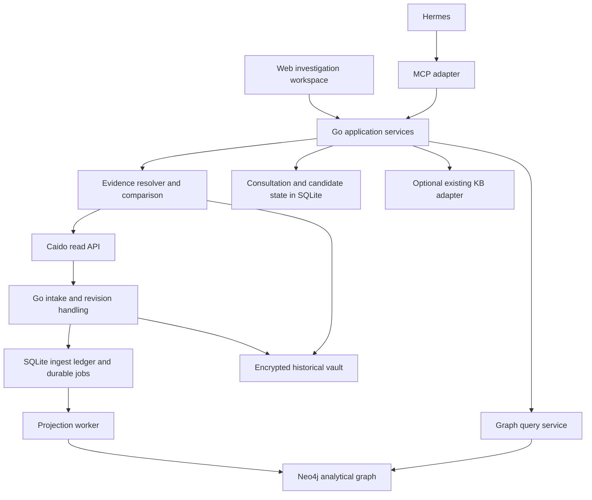

# Core architecture v2 — approved plan

Status: **APPROVED — architecture and six-stage sequence approved on 2026-10-23.**

Date: 2026-10-23. Source baseline: `2800260`, with the uncommitted direct
Neo4j neighborhood and web navigation feature also reviewed separately.

## 1. Product outcome

Build a personal, human-led consultation workspace around captured application
behavior. The analyst must be able to select a request, understand its inputs
and response, trace evidence-backed relationships, compare actors and objects,
discuss a suspected issue, save a candidate, and resume the investigation.

Neo4j remains the required analytical graph. Hermes remains the assistant
harness. Go remains the application runtime. KB expansion stays deferred and
is not a prerequisite for the core workflow.

The existing evidence ingestion, encryption, project identities, parser
projections, assertion validation and outbox primitives are retained. This is
an incremental migration inside the existing application.

## 2. What the review found

The current foundation is suitable for an evidence navigator. It is not yet an
end-to-end consultation product. The following findings drive this proposal.
They are source-review findings; conditional failure scenarios were not
reproduced during this review.

| Priority | Finding and consequence | Evidence |
| --- | --- | --- |
| P1 | Snapshot replacement can remove an event applied after the local snapshot was read; retained import markers can suppress its replay. Parity against the older snapshot can still pass. | `cmd/bb-assistant/main.go:203`, `:230`; `internal/neo4jstore/store.go:199`, `:345` |
| P1 | Live deduplication skips all known IDs, including exchanges with missing or incomplete responses. A later response is not refreshed by the current live path. | `internal/ingest/live_tail.go:224`, `:452`, `:597`, `:629` |
| P1 | Neo4j draining is synchronous inside ingestion. A graph outage can block capture/checkpoint progress after a separate graph transaction has committed. | `internal/ingest/page_writer.go:382`, `:428`, `:579`; `internal/ingest/live_tail.go:298`, `:303` |
| P1 | Actor, session, tenant, object and policy context are unknown; live semantic/business analysis is explicitly unimplemented. Schema vocabulary alone does not supply those relationships. | `internal/graph/historical.go:441`; `internal/graph/live.go:56` |
| P1 | Hermes receives structural summaries, but has no integrated semantic evidence broker or application-owned save/resume consultation cycle. | `internal/search/capture_detail.go:12`; `scripts/setup-hermes:52`; `internal/mcpserver/server.go:290` |
| P1 | Signature-filtered historical capture search now uses an app-owned, indexed Neo4j lookup and no longer downloads the full project. Existing Neo4j snapshots need a controlled reproject before this lookup is available; a generation-bound marker fails closed after older-writer updates. Live compatibility and query-plan cost remain unverified. The direct view now loads a bounded set of analysis cards and exposes summaries in the inspector; its opt-in Neo4j integration check has not been run. Recorded 50–102 second cold reads belong to the former full-snapshot path; newer bounded-view measurements cover only two query shapes. | `internal/search/captures.go`; `internal/graphaccess/signatures.go`; `internal/neo4jstore/store.go`; `internal/neo4jstore/analytical_slice_integration_test.go`; `docs/PROJECT-STATUS.md` |
| P1 | Resolved in the Stage 2 implementation: stale surface responses are rejected across project and filter changes. | `internal/webui/assets/app.js` |
| P2 | Display route masking can merge distinct operations, while source-bound graph aliases can fragment equivalent routes. There is no separate reviewed operation grouping layer. | `internal/graph/projection.go:163`; `internal/graph/historical.go:127`, `:518`, `:634` |
| P2 | Direct graph neighbors and local operation browsing now have bounded continuation/filter contracts. Catalog materialization is bounded, but each page rescans the full local structural index for exact totals and a snapshot fingerprint; large-index latency is unmeasured. Native analytical candidate limits remain partial; operation counts cover only indexed local records and do not establish complete Caido history. | `internal/neo4jstore/neighborhood.go:248`; `internal/search/surface_catalog.go` |
| P2 | UI and MCP orchestration live in MCP-owned methods, errors lose operational causes, deployment/runbooks still mix Python and Go checkpoints. | `cmd/bb-assistant/main.go:859`; `internal/webui/server.go:212`; `deploy/bb-assistant-caido-tail.service:21`; `GO-MIGRATION.md` |

### Strengths to preserve

- Stable instance/project/request identity and explicit project predicates.
- Exact capture references, revisions, hashes, fidelity and source provenance.
- Reified assertions with context, origin and evidence state.
- Historical encrypted vault and live in-memory parsing with keyed signatures.
- Normalized graph writes and checksummed outbox events committed together;
  idempotent Neo4j application with transaction-local import markers.
- Explicit missing evidence, contradictions and partial parsing.
- Harness-independent application contracts and an isolated Hermes profile.

## 3. Target topology



The arrows describe the proposed architecture, not current completed wiring.
HTTP, CLI and MCP adapt the same typed application use cases. Hermes requests
operations and proposes interpretations; application code owns scope,
validation, persistence and evidence references.

## 4. Storage responsibilities

| Store | Owns | Lifecycle |
| --- | --- | --- |
| Caido | Live raw request/response source and original request IDs | Fetch selected exchanges on demand; expose unavailable/deleted source explicitly |
| Encrypted vault | Raw revisions retained by explicit historical import | Preserve revision/side binding, fidelity, key version and retention references |
| SQLite ingest ledger | Capture identity/revisions, source checkpoint, durable jobs, projection acknowledgment and recovery records | Authoritative local commit before analytical projection; replayable after failure |
| SQLite consultation store | Sessions, analyst annotations, selected evidence, comparisons, candidate versions and audit events | Per-project ownership; immutable revisions with explicit review transitions |
| Neo4j | Queryable application behavior graph and evidence relationships | Derived, versioned and rebuildable from durable local records |
| Existing KB index | Optional reference retrieval | Remains unchanged for this work |

Neo4j is the normal graph query path. SQLite's normalized BehaviorGraph is
retained as a recovery/compatibility projection during migration. It does not
remain on every interactive graph read. New writes go through application
services and durable jobs rather than independently editing both stores.

### Ingestion and failure recovery

1. Keep one stable capture identity per Caido instance/project/request ID.
2. Append immutable capture revisions. Track response lifecycle separately
   from parse completeness: pending, present, absent-final or unresolved.
3. Commit accepted revision metadata, structural indexes, checkpoint and
   durable projection job in one defined SQLite ledger transaction. Retain a
   replayable sanitized payload for the job. Publish retained encrypted blobs
   before the referencing commit; reclaim unreferenced blobs separately.
4. A background worker updates the compatibility graph and Neo4j
   idempotently, then acknowledges the job. Neo4j unavailability increases lag
   without rolling back accepted source progress.
5. Retry incomplete or unsettled exchanges through a bounded refresh queue;
   a known request ID is not evidence that its response revision is final.
6. Serialize snapshot replacement with intake/materialization through a
   project-scoped maintenance lock first. Record the projection sequence.
   Online staged-generation rebuild can be added later if short maintenance
   windows become a measured problem.

The initial implementation should use a local SQLite jobs table and a Go
worker. Define retry/backoff, dead-letter inspection and replay explicitly.

## 5. Graph model

The graph is a directed, typed multigraph with source references on assertions.
Keep observed facts, deterministic/heuristic links and analyst/model proposals
distinct.

### Entities and relationships

- **Project / Origin / Operation:** operation is method plus a versioned
  canonical route family in one origin/project. Optional query-field sets
  describe request shapes rather than creating a new operation identity.
- **Capture / CaptureRevision / RequestVariant / ResponseVariant:** preserve
  exact evidence identity, message extent, shape and fidelity.
- **FieldOccurrence:** side, location, path, occurrence index, type and
  source span. Repeated parameters remain separate occurrences.
- **Actor / Session / Role / Tenant:** explicit analyst labels and pseudonymous
  session versions, with evidence and annotation origin.
- **ObjectReference / ValueReference:** selected project-keyed equality tokens
  support field correlation without retaining raw secret values. Equality is
  a correlation, not proof of object identity, ownership or a data-flow cause.
- **Flow / FlowStep:** analyst-defined groups and observed navigation/order
  evidence. Missing initiator/timestamps remain unknown.
- **Annotation / Comparison / Hypothesis:** versioned interpretations with
  references to exact captures, assertions and graph generation.

Typical questions become expressible as bounded queries:

- Which operations use this field or object reference?
- Where was a value observed in a response and later in a request?
- What changed between these two request/response pairs?
- What was observed for actor A versus actor B under the selected context?
- Which captures support this proposed relationship, and what is missing?

### Route identity and display

Separate exact URL identity, operation grouping and the display label. Keep
legacy immutable IDs. Add a versioned grouping projection and explicit alias
relationships instead of silently rewriting old endpoints. Preserve static
route meaning where policy permits, expose ambiguous grouping, and let the
analyst assign readable project-local names. An unfamiliar segment must not be
displayed as a proven dynamic parameter merely because it was masked.

### Neo4j representation and query API

Retain assertion nodes for independent provenance, contradiction and proposal
state. Promote safe query fields into indexed native properties: operation
key, method, field path/location, shape key, capture/revision key and context
labels. The validated payload remains available for round-trip compatibility.

Expose typed queries for operation search, filtered neighborhoods, bounded
paths, field occurrences, capture comparisons and source/card closure. Each
query returns generation, limits, continuation, omissions and integrity scope.
Pin continuation to a graph generation and return an explicit stale-cursor
result when that generation is no longer available.

Short-lived CLI graph queries persist only their bounded, generation-bound
continuation session in an owner-only query-state database so a later CLI
invocation can resume it. HTTP and MCP services keep their cursor sessions
process-local. The query-state database is separate from project capture and
graph stores.

Use one process-owned Neo4j driver and short-lived sessions. Partition cache
coordination by project/generation. Full-project checksum/parity scans remain
maintenance operations. Evidence queries must retain relevant contradiction
and source closure; the current direct web view must not silently inherit
stronger analytical guarantees.

This follows Neo4j's documented [driver lifecycle guidance](https://neo4j.com/docs/go-manual/current/connect/)
and [bounded/lazy result guidance](https://neo4j.com/docs/go-manual/current/performance/).
Generation rechecks remain necessary: Neo4j's default
[read-committed isolation](https://neo4j.com/docs/operations-manual/current/database-internals/concurrent-data-access/)
does not turn a sequence of reads into an immutable snapshot.

## 6. Evidence and consultation services

### Evidence resolver

Resolve an exact capture revision from the historical vault or selected Caido
project. Prefer direct ID lookup or validated indexed metadata; avoid scanning
the entire history to open one exchange. Apply cancellation, byte/time budgets
and explicit unavailable/revision-changed results.

Offer two deliberate outputs:

- A local analyst view of the selected request/response, including headers,
  query/body fields, repeated inputs, truncation and parser warnings.
- A bounded model-visible evidence packet with selected excerpts,
  redactions, source spans, hashes/revisions, omitted data and policy version.

The packet is assembled around the analyst's question and chosen comparisons.
A transport-size ceiling alone is not a model-context budget. The model
provider remains unset until the operator selects it; the chosen route and
permitted evidence classes become application configuration/session metadata.

### Consultation state and workflow

An application-owned session records the question, human-selected projects,
evidence policy, graph generation, selected captures, accepted facts,
annotations, unresolved questions, comparison results and candidate versions.
Tool calls are checked against that session's project set.

```text
question → select evidence → inspect/compare → propose explanation
→ validate citations and alternatives → save candidate → human review/resume
```

Separate deterministic enrichment, analyst annotations and model proposals.
Store candidates through an explicit local write use case; the current
read-only tool catalog must not disguise that write as retrieval or a skill
edit. Preserve candidate/reproducing/reproduced/verified distinctions. Citation
validation alone cannot establish impact or grant verified status.

The first complete cycle uses synthetic evidence and an injectable fake model
adapter. A real Hermes/provider evaluation follows provider selection and an
approved data boundary. KB absence must be visible without preventing
structural evidence comparison or candidate saving.

## 7. Web investigation workspace

The web workspace provides four connected views:

1. **Operation catalog:** server-side filtering and endpoint-level pagination,
   meaningful labels, method/origin, capture counts and specific coverage gaps.
2. **Focused graph:** one small neighborhood, expand by relation/direction,
   continuation, back navigation, inspected assertions and evidence state.
3. **Evidence/comparison:** selected request/response, field occurrences,
   side-by-side differences and explicit actor/object/flow annotations.
4. **Consultation/candidates:** question, grounded explanation, evidence links,
   alternatives, missing checks, saved state and resume.

The existing small embedded UI can deliver the initial version. Extract API
state, graph rendering, inspector, evidence comparison and consultation into
separate modules as those features arrive. Surface and graph requests must
both reject stale responses after project changes.

Present source enumeration, revision freshness, parsing, contextual enrichment,
projection lag, selected query completeness and viewport filtering separately.
An overall PARTIAL state can remain, but the analyst must see its specific
causes and next available action.

## 8. Application boundaries and operations

Use one Go application with internal modules for intake, projection, graph
queries, evidence, consultation and project state. HTTP, MCP and CLI are thin
adapters over shared typed use cases. Keep provider and Hermes adapters outside
domain logic. Introduce interfaces only at concrete I/O boundaries.

Return safe typed errors: invalid input, source unavailable, stale revision or
cursor, backend unavailable, schema mismatch, integrity failure, timeout and
budget exceeded. Record sanitized stage/duration/count diagnostics and a local
diagnostic ID. Keep raw values out of logs and shared graph metadata.

Provide one managed Go launcher/configuration for web, sync worker and MCP.
Move production tail ownership from the legacy Python service after parity is
demonstrated. Keep Python KB tooling and the old runtime as explicit temporary
compatibility paths. Maintain one current environment/capability summary;
historical checks must be labeled by checkpoint rather than read as current
capabilities.

## 9. Implementation sequence and approval gates

The operator approved the architecture and this sequence on 2026-10-23.
Routine implementation, local verification and Git commits follow this plan.
Provider choice remains an operator decision. KB remains deferred.

| Stage | Deliverable | Acceptance criteria |
| --- | --- | --- |
| 1. Consistency and current UI correctness | Project maintenance lock; revision-aware pending refresh; asynchronous durable projection; stale surface response fix | Synthetic failure/restart/concurrency cases preserve accepted captures and all projection events; later responses update revisions; switching projects never mixes display state |
| 2. Shared graph query service | Shared typed HTTP/MCP use cases; process-owned driver; native bounded Neo4j queries; generation/cursors; indexed operation catalog | Selecting one request avoids a full snapshot load; omitted neighbors are reachable through continuation; analytical closure remains explicit; proposed local p95 target is under 2 seconds for a focused view on a declared reference dataset |
| 3. Canonical operations and context | Versioned grouping, field occurrences, analyst actor/session/object/flow annotations and selected equality links | Distinct static operations stay distinct; repeated equivalent operations can group without changing old evidence IDs; unknown ownership/causality stays unknown; every derived link states its basis |
| 4. Evidence workspace | Exact evidence resolver, local request/response view, deterministic comparisons, bounded model packets | The analyst can inspect and compare two captures; spans/revisions resolve; truncation/redactions/missing source are visible; ordinary navigation never emits raw values to a model |
| 5. Complete consultation cycle | Session store, candidate versions, citation checks, save/resume, Hermes adapter | Synthetic scenario runs question → evidence → comparison → proposal → validated references → saved candidate → resume; real model check waits for provider selection |
| 6. Managed local operation | Go service/runbook cutover, lag/failure diagnostics, backup/restore contract | One documented startup path; new live intake and restart/replay demonstrated; restoration retains evidence/receipt references and a current capability summary |

The latency target is proposed acceptance work, not a measured result. Declare
hardware, dataset, query shape, generation, cold/warm state and omissions for
any performance result. Separate standalone evidence integrity from full source
coverage; a passing focused query does not imply a complete Caido snapshot.

## 10. First approved development slice

Start Stage 1 with focused fixes to the surface project-switch race, project
maintenance coordination and live capture revision lifecycle. Then move the
Neo4j drain out of the ingest commit path through a durable local job contract.
Finish and verify the existing direct-neighborhood feature against the shared
query contract during Stage 2.

Keep existing evidence recoverable throughout migration. Schema upgrades and
new grouping projections must have explicit versions, replay rules and a
rollback path. The approved architecture is being implemented incrementally;
this document is not a claim that the above services already exist.

## Review scope and limits

Reviewed intake, storage, graph writer/readers, Neo4j materialization and
working-tree neighborhood code, web/MCP boundaries, Hermes profile, roadmap
and deployment documentation. Three bounded independent source reviews were
validated by the coordinator. No new tests, runtime benchmarks, database reads
or mutations, target traffic, model calls or KB operations were performed for
this architecture review. Existing recorded runtime checks were used only as
historical evidence. Source findings identify reachable mechanisms; they are
not claims of observed data loss or exploitation.
