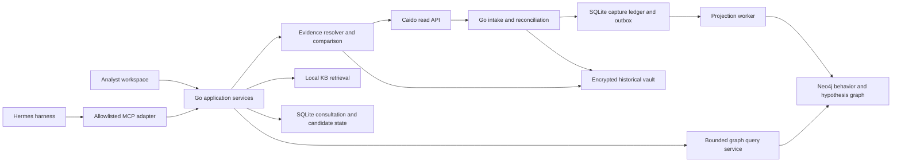

# Future architecture: graph-guided vulnerability analysis

**Status:** Proposed direction for discussion. This document extends the
approved [core architecture v2](ARCHITECTURE-V2-PROPOSAL.md); it does not
replace that plan or claim that the future capabilities below are implemented.

**Product goal:** a local-first assistant that helps one analyst understand
captured application behavior, find evidence-backed vulnerability hypotheses,
and decide what to inspect next. The analyst remains responsible for scope,
interpretation, and any validation outside the application.

## 1. What this architecture adds

The approved core already establishes the main foundations: Go application
services, Neo4j for analytical queries, SQLite for durable local state and
projection jobs, Caido as the capture source, Hermes as the assistant harness,
and a provenance-backed consultation workflow.

The proposed future direction makes three capabilities explicit:

1. A graph with separate semantics for **observed behavior**, **derived
   relationships**, and **hypotheses**.
2. A staged, evidence-bounded harness that asks the model to interpret a small
   graph slice and exact captures instead of treating the whole graph as
   prompt context.
3. A repeatable evaluation set that measures evidence accuracy and useful
   analysis before adding model routing or more automation.

The target remains an analyst's workbench. It does not become an autonomous
reconnaissance or exploit agent.

## 2. Product boundaries

### In scope

- Read and reconcile only the Caido projects selected for the current analysis.
- Organize HTTP operations, field occurrences, response shapes, actor labels,
  object references, and explicitly observed navigation context.
- Resolve graph results to exact Caido request IDs and capture revisions.
- Compare selected exchanges and retrieve relevant local KB sources.
- Create a candidate with evidence, alternatives, missing context, and a
  minimal next inspection step.
- Preserve the candidate's history and let the analyst resume the work.

### Out of scope

- Sending requests to a target, running payloads, or changing target state.
- Promoting a model answer, graph path, KB match, or score to a confirmed
  vulnerability by itself.
- Treating route templates, Referrer headers, timestamps, or shared values as
  proof of causality or object ownership.
- Sending real capture content to a model until its provider and retention
  boundary have been reviewed and explicitly configured.
- Making source-code analysis or CodeQL a prerequisite for the Caido traffic
  workflow.

The application may record evidence from an independently authorized check,
but it does not dispatch that check. Its local evidence and status validators
must continue to distinguish `candidate`, `reproducing`, `reproduced`, and
`verified`.

## 3. Target topology



The Go application owns project selection, input validation, policy checks,
query budgets, evidence resolution, and persistence. Hermes chooses among
available read and consultation operations and proposes interpretations. A
model tool call remains a request; application code validates it against the
active session and project set.

SQLite and Neo4j retain their approved responsibilities. SQLite is the
durable, replayable local record for accepted capture revisions and work to be
projected. Neo4j is the normal path for bounded analytical graph queries. The
outbox, idempotent projection, visible lag, and reconciliation operations
remain necessary because these stores do not share a transaction.

## 4. Graph semantics

Keep one project-scoped graph with explicit types and provenance. The first
implementation should not create a second graph database for hypotheses.
Separate the layers through node and relationship types, application write
contracts, and query results. A later scale or isolation requirement can
justify a separate store.

### 4.1 Observed layer

This layer contains facts extracted from selected captures:

- origin, operation, capture, and immutable capture revision;
- request and response variants, field occurrences, and parser coverage;
- explicit analyst actor/session labels and selected object references;
- exact evidence references, hashes, source revision, and fidelity state.

An observed fact must point to its source capture revision. Missing response
bodies, parse truncation, unknown actors, and unavailable history stay visible
as gaps.

### 4.2 Derived relationship layer

This layer contains deterministic or heuristic links used for navigation and
comparison, such as normalized operation grouping, repeated field shapes,
redirects, Referrer matches, and selected value correlations.

Every relationship records its method and strength basis, for example exact
normalized URL, route-template fallback, parser rule version, or analyst
annotation. A match score describes the match; it is not vulnerability
probability. Ambiguous template matches remain ambiguous.

### 4.3 Hypothesis layer

This layer contains analyst- or model-proposed interpretations. Useful typed
records include:

- `Hypothesis` — the suspected mechanism, affected operation, impact if
  confirmed, and current state;
- `Precondition` — what must be true for the mechanism to apply;
- `ExpectedObservation` — what evidence should differ if the hypothesis is
  correct;
- `AlternativeExplanation` — a plausible benign explanation and its
  distinguishing prediction;
- `ValidationPlan` — the smallest next evidence check, stated without
  dispatching a target request;
- `EvidenceLink` — exact captures, revisions, fields, KB source spans, and
  graph generation used by the proposal.

Hypothesis edges never become observed edges. Only an explicit application
service can save a proposal, and saving it cannot mark it `verified`. State
transitions require the existing independent evidence validator and the
applicable human review.

### 4.4 Optional source-code graph

If source-code review becomes a deliberate product mode, add it as a separate
connector with pinned repository and commit identity. Model code entities,
calls, and dataflow with their own provenance and query contract. Join an HTTP
operation to a code handler only when the mapping is supported by source
evidence. Keep this optional: a source call graph answers different questions
from a graph of observed HTTP behavior.

## 5. Analyst workflow and harness

```text
select project and inspect coverage
  → query a bounded graph slice
  → choose exact captures and revisions
  → inspect or compare request/response evidence
  → retrieve focused KB sources
  → propose a mechanism, preconditions, and alternative explanation
  → validate citations and missing-evidence statements
  → save a candidate and resume it later
```

Each step returns a typed result with project identity, graph generation,
limits, omissions, source references, and relevant parse state. The model does
not receive an unbounded graph dump. The operator sees and accepts the
model-visible evidence packet under the configured data policy.

### Responsibilities by component

| Component | Responsibility |
| --- | --- |
| Go application | Enforce project scope, validate tool arguments, query budgets, resolve exact evidence, persist consultation state, validate citations, and emit explicit partial/error states. |
| Neo4j | Answer indexed, bounded neighborhood, comparison, and path queries over typed project data. |
| SQLite | Preserve capture ledger, projection jobs, consultation sessions, candidate versions, and local audit events. |
| Caido | Remain the canonical source for live raw exchanges and original request IDs. |
| Encrypted vault | Retain only explicitly imported historical raw revisions under the existing local retention policy. |
| Hermes | Orchestrate the allowlisted workflow and present model proposals. |
| Local KB | Ground a suspected mechanism with versioned sources and applicable spans. It supplies knowledge, not authorization. |
| Analyst | Select evidence, approve any model disclosure, decide whether a candidate is useful, and perform any external validation. |

Hermes stays replaceable behind the application boundary. No harness toolset
gets terminal, file, browser, arbitrary network, or target-request capability.
Skill and prompt changes remain versioned proposals, tested with synthetic or
redacted fixtures before adoption.

## 6. Model strategy

Keep one configured model route as the default until repeatable evaluations
show a quality or cost reason to add routing. If routing is later justified,
assign work by measured capability:

| Work | Candidate route | Required control |
| --- | --- | --- |
| Short summaries, field-shape classification, or query refinement | Smaller/cheaper model | Check output against deterministic graph facts and exact citations. |
| Mechanism analysis, counterexample generation, or review of a complex candidate | Stronger model | Provide the same bounded evidence contract; require cited claims and alternatives. |
| Project selection, access boundaries, persistence, citation checks, and status changes | Application code | Never delegate these decisions to a model. |

Compare models with a fixed evaluation set before enabling routing. Record
model and prompt versions, route selection, latency, token use, citation
quality, unsupported claims, and candidate usefulness. Do not infer
vulnerability likelihood from a model confidence score.

Real capture content stays out of provider context while retention and data
handling remain unverified. Synthetic or explicitly redacted fixtures are the
evaluation default.

## 7. Evidence and quality gates

The workflow should fail closed or report `PARTIAL` when it cannot establish
the evidence boundary. At minimum, the following gates apply:

1. **Scope gate:** every graph, evidence, and KB request is bound to the
   selected project set; no implicit cross-project query.
2. **Coverage gate:** show capture enumeration, pending revisions, parser
   truncation, projection lag, and graph generation before interpretation.
3. **Provenance gate:** every factual claim in a candidate resolves to an
   exact capture revision or a versioned KB source span.
4. **Interpretation gate:** mark each statement as observed, derived, or
   proposed; include a benign alternative and a prediction that distinguishes
   it from the suspected mechanism.
5. **Disclosure gate:** show the model-visible packet and apply the configured
   redaction and provider policy before a model call.
6. **Persistence gate:** save a candidate through a typed application use case;
   preserve revisions and review history.
7. **Promotion gate:** keep `verified` unavailable to model proposals,
   retrieval, and graph reachability alone. Require the separate evidence
   validator.

The current product does not send validation requests. A candidate may state a
recommended next check for the analyst, with the missing authorization or
evidence clearly identified.

## 8. Evaluation plan

Build a versioned fixture set from synthetic or safely redacted exchanges. It
should include ordinary behavior, ambiguous route grouping, repeated
parameters, missing/truncated responses, actor/object comparisons, benign
alternatives, and examples where a graph path looks compelling but has no
causal evidence.

Measure these properties independently:

- **Evidence resolution:** exact cited request IDs and revisions resolve;
  stale or missing revisions are reported accurately.
- **Graph correctness:** bounded queries return the expected nodes, edges,
  provenance, ambiguity, and omission counts.
- **Interpretation quality:** claims match the evidence; alternatives and
  preconditions are explicit; unsupported causal claims are counted.
- **Coverage honesty:** incomplete intake, parse state, KB gaps, and projection
  lag remain visible in the answer and candidate.
- **Workflow reliability:** project isolation, operator preview, save/resume,
  and state transitions behave consistently across restarts.
- **Operational cost:** latency and token use are reported for declared query
  shapes and dataset sizes.

Model evaluations are not vulnerability confirmation. A fixture score is not
production coverage. Retain the evidence and model/prompt versions for each
evaluation run so regressions can be compared.

## 9. Delivery sequence

The approved six-stage v2 implementation remains the foundation. Extend it in
this order, keeping runtime readiness separate from feature presence:

| Order | Future increment | Exit evidence |
| --- | --- | --- |
| 0 | Close the approved runtime-integrity work on selected real local data. Reconcile Caido history, demonstrate intake/restart replay, measure SQLite-to-Neo4j parity, and exercise backup/restore. | Dated artifacts show the selected project, exact limits, parity result, restart/replay result, and remaining gaps. Until then, the system reports `PARTIAL`. |
| 1 | Complete operation and field context: robust operation grouping, repeated field occurrences, explicit actor/session/object annotations, and evidence comparison. | Fixtures and selected-data checks show no silent merge of distinct operations and preserve ambiguity and provenance. |
| 2 | Add the hypothesis overlay and graph queries for preconditions, alternatives, and discriminating evidence. | A candidate can be created, challenged, cited, resumed, and kept separate from observed facts. |
| 3 | Establish the evaluation set and score the end-to-end Hermes workflow on synthetic/redacted data. | Reproducible baselines cover citation correctness, unsupported claims, coverage reporting, and save/resume behavior. |
| 4 | Consider model routing only if measured results justify its complexity. | A held-out fixture comparison demonstrates a meaningful quality, latency, or cost improvement without weakening evidence gates. |
| 5 | Consider a source-code/CodeQL connector only if source review is an explicit product requirement. | A separate design defines repository identity, licensing, dataflow provenance, and a validated route-to-code mapping. |

No increment above authorizes active target requests or real-capture provider
disclosure. Those boundaries require separate review and an explicit change to
the project contract.

## 10. Decisions and open questions

These are proposed future choices, not new accepted implementation decisions:

- Keep hypothesis records in the existing Neo4j deployment with separate
  labels/types and application write contracts; revisit a separate store only
  for a measured isolation or scaling need.
- Keep the current single-model route until evaluation justifies model
  routing.
- Use CodeQL as an optional source-analysis connector, not as a dependency of
  Caido history analysis.
- Keep the current no-target-request boundary.
- Require a provider-retention review before any real capture content enters a
  model context.

The most important unresolved delivery question is operational: when can the
selected Caido project's history, Neo4j projection, KB snapshot, and recovery
path all be demonstrated against the exact local working data? This document
does not claim that those checks have passed. See
[current capabilities](CURRENT-CAPABILITIES.md) and
[project status](PROJECT-STATUS.md) for the recorded baseline; refresh the
local status before treating it as a live measurement.

## 11. How the external references apply

- [Awesome LLMs for Vulnerability Detection](https://github.com/huhusmang/Awesome-LLMs-for-Vulnerability-Detection)
  is a research and project index. Use it to find candidate techniques and
  evaluation papers, not as an implementation specification.
- [ZephrFish harness-kit](https://github.com/ZephrFish/harness-kit) is a
  template illustrating staged orchestration, context budgets, and routing.
  Its README describes it as a template rather than a ready-to-run product.
  Borrow evaluation questions and stage boundaries, not its assumptions about
  autonomous recon or target actions.
- [Thinking in Graphs: Neo4j-Backed Exploit-Chain Reasoning](https://arxiv.org/abs/2610.20902)
  is relevant to typed steps, preconditions, and graph-assisted reasoning. Its
  reported examples are synthetic; they motivate a hypothesis overlay but do
  not establish that the same design improves this product's Caido workflow.
- [How Much Does the Harness Matter, and for Whom?](https://arxiv.org/abs/2610.28802)
  studies source-code vulnerability discovery and call-graph context. It
  supports evaluating context and harness choices by model size, while its
  results should not be generalized directly to captured HTTP behavior.

The transferable principle is to give the model a small, typed, provenance-rich
slice and require it to state what the evidence supports, what remains
unknown, and what observation would distinguish competing explanations.
